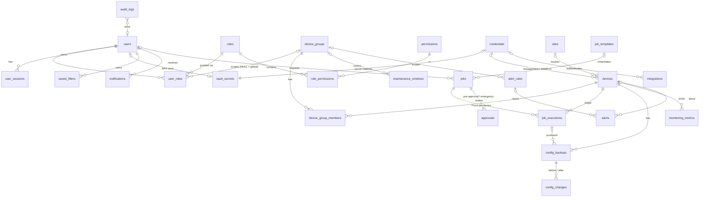

# InfraPilot — Architecture, Module Breakdown, ERD

InfraPilot is a self-hosted platform to inventory, monitor, configure and automate Windows and
Linux servers, switches/routers/APs, firewalls, virtualization hosts and storage, with RBAC,
approvals and a tamper-evident audit trail.

## 1. Runtime architecture

```
                    ┌──────────────────────────── Ubuntu 22.04 / 24.04 host ──────────────────────────────┐
 Browser ──HTTPS──► │ proxy  (nginx: TLS 1.2/1.3, HSTS, CSP, rate limits, static React build)               │
                    │   └── /api/*  ─────────► api     (FastAPI + uvicorn, OpenAPI at /api/docs)            │
                    │                              │                                                       │
                    │                              ▼                                                       │
                    │                         mssql   (SQL Server 2022, volume mssql-data)                  │
                    │                              ▲                                                       │
                    │ worker (same image)  ────────┘  job queue consumer · monitoring poller · scheduler     │
                    │   └── drivers ──► WinRM/PSRP · SSH · Netmiko CLI · REST/XML APIs · SNMPv3 · ICMP      │
                    │   └── ansible-runner (per-job isolated private data dirs)                             │
                    └───────────────────────────────────────────────────────────────────────────────────────┘
 Networks: frontnet (proxy↔api), backnet (internal: api/worker↔mssql). Only the proxy publishes ports 80/443.
```

Design decisions

* **No message broker.** Jobs live in SQL Server. Workers claim jobs with an atomic
  compare-and-set (`UPDATE … WHERE id=? AND status='queued'`), so any number of worker
  threads/containers can run safely (covered by a concurrency test).
* **Operations catalogue, not commands.** Every action is a named, typed operation
  (`windows.service.restart`, `network.vlan.create`, `firewall.rule.set_enabled`, …) with a
  Pydantic parameter model (strict allow-list patterns), a risk level (`read` / `change` /
  `critical`), check-mode support, secret-parameter declarations and a human-readable change
  description. The UI sends only an operation id and parameters; the server validates per driver.
  * Windows: values are bound as PowerShell parameters through PSRP — never concatenated into code.
  * Linux: argument lists joined with `shlex.join`; "approved commands" are fixed argv templates.
  * Network: validated VLAN IDs / interface names into vendor config lines.
* **Drivers declare capabilities.** An operation a vendor cannot do safely is simply not
  declared; requests for it return `unsupported` — never `succeeded`.
* **Change safety.** Changes capture before/after state (running config, ACLs, service state),
  verify the result by reading it back, store a unified config diff, and record rollback
  instructions. Dry-run (check mode) is offered where the platform supports it.
* **Secrets.** AES-256-GCM envelope encryption; the master key is a Docker secret outside the
  database. Credential material, MFA seeds, SMTP/LDAP passwords and secret job parameters
  (e.g. a new user's password) are sealed in `vault_secrets`; job rows only hold a reference.
* **Tamper-evident audit.** Each audit row stores `prev_hash` and
  `hash = SHA-256(canonical JSON incl. prev_hash)`. On SQL Server an `INSTEAD OF UPDATE, DELETE`
  trigger rejects modification, the application login is `DENY UPDATE, DELETE, ALTER` on the
  table, and appends are serialised with `sp_getapplock`. `GET /api/audit/verify` and
  `infrapilot-health-check --verify-audit` recompute the chain.
* **Least privilege at the database.** Migrations run as `sa` from the one-off tools container;
  the application login (`infrapilot_app`) only has `db_datareader` + `db_datawriter`.

## 2. Repository / module breakdown

| Layer | Path | Responsibility |
|---|---|---|
| Frontend | `frontend/src/components/ui` | Design-system primitives (Button, Card, Table, Modal, ConfirmDialog, Badge, Tabs, Toast, EmptyState, Skeleton, DiffView) |
| | `frontend/src/components` | Layout (sidebar, global search, notification centre, theme), SchemaForm (renders operation forms from JSON Schema), OperationRunner (preview → confirm → submit), DeviceForm, DevicePicker |
| | `frontend/src/pages` | Dashboard, Devices, DeviceDetail, Sites & Groups, Credentials, Jobs, JobDetail, Automation, Approvals, Alerts, Audit, Users & Roles, Integrations, Settings, Onboarding wizard, Account security |
| | `frontend/src/lib` | API client (cookie session + anti-CSRF header), auth context, types, formatting |
| Backend | `app/core` | config, DB engine, logging with secret redaction, vault, password/TOTP helpers, permission catalogue, rate limiter, errors |
| | `app/models.py` | SQLAlchemy ORM (28 tables, SQL Server types) |
| | `app/services` | auth & RBAC, LDAP, jobs/approvals/maintenance windows, audit, devices, configs (backup/diff/redaction), monitoring & alerting, notifications (e-mail), import/export, discovery, integrations (Zabbix/LibreNMS), settings, bootstrap seed |
| | `app/drivers` | `base.py` framework; `windows.py`, `linux.py`, `network.py` (Cisco IOS/XE, Aruba AOS-CX, HPE ProCurve, TP-Link JetStream, MikroTik), `firewall.py` (FortiGate, Sophos), `virtualization.py` (Proxmox, vCenter), `snmp.py` (ICMP/TCP/SNMPv3, generic SNMP devices), `simulated.py` (demo mode), `registry.py` |
| | `app/services/gpo/` (1.1) | `parser` (Get-GPOReport/gpresult XML), `knowledge` (readable categories + 100-rule baseline), `analysis` (precedence, conflicts, baseline, diffs), `store` (collections, deduplicated snapshots, change alerts), `report` (15-section report) |
| | `app/services/ad.py` (1.1) | LDAPS paged sync (ldap3), recursive privileged membership, change detection, 13 reports |
| | `app/services/compliance/` (1.1) | `catalog` (ISO 27001/CIS/NIST/RBI controls), `checks` (24 automated evidence checks), `service` (assessments, findings lifecycle, evidence, audit report) |
| | `app/services/reporting/` (1.1) | `render` (one document model → PDF/Excel/CSV/HTML), `center` (12 templates, schedules, e-mail) |
| | `app/automation/runner.py` | ansible-runner execution, approved playbook catalogue with typed variables |
| | `app/api` | routers (auth, users, devices, credentials, operations, governance, monitoring) and UI serializers |
| | `app/worker` | job threads, monitoring poller, scheduler (maintenance windows, approval expiry, scheduled config backups, integration sync, metric retention, escalation) |
| | `app/cli.py` | `bootstrap-db`, `migrate`, `create-admin`, `reset-admin-password`, `verify-audit`, `worker-health` |
| | `migrations/` | Alembic (initial schema + SQL Server audit trigger) |
| | `playbooks/` | Ansible playbooks (Linux packages/services/maintenance/baseline, Windows software/services/shares/baseline) |
| Deploy | `install.sh`, `lib/`, `deploy/` | installer wizard, compose, nginx, env template, maintenance scripts, offline bundle builder |

## 3. Database ERD



Main tables (identity PKs; timestamps DATETIME2 UTC; JSON in NVARCHAR(MAX)). Full DDL: `docs/schema-mssql.sql`.

* **users**, **roles**, **permissions**, **role_permissions**, **user_roles**(user, role, device_group NULL=global), **user_sessions**(SHA-256 of opaque token, expiry, idle)
* **vault_secrets**(purpose, ciphertext, nonce, wrapped data key, key nonce, key_version)
* **credentials**(name, kind password|winrm|ssh_key|api_token|snmpv3, username, secret_id, non-secret options JSON)
* **sites**, **devices**(hostname, IP/DNS, type, platform/driver, OS, vendor, model, firmware, serial, owner, site, department, location, environment, tags, credentials, port, verify_tls, simulated flag, status, last checked/success, last error, soft delete), **device_groups**, **device_group_members**, **saved_filters**
* **job_templates**, **jobs**(operation/playbook, params with vault refs, risk, check mode, emergency, requires_window, status, timeout, cancel flag), **job_executions**(per device: status, output, data, before/after, verification, rollback hint)
* **approvals**(pre | emergency_review, status, reason, decision), **approval_policies**(risk, category, environment → require approval / window), **maintenance_windows**(time range, environment/group scope, auto-approve medium-risk)
* **config_backups**(content, SHA-256 of normalised text, dedupe), **config_changes**(unified diff)
* **alert_rules**, **alerts**(fingerprint dedupe, count, ack/resolve/escalation), **notifications**, **monitoring_metrics**(indexed device, metric, ts)
* **integrations**, **audit_logs**(hash chain), **system_settings**
* 1.1: **gpo_collections**, **gpo_snapshots**(unique domain+guid+sha256), **gpo_collection_items**; **ad_domains**, **ad_objects**(unique domain+guid),
  **ad_changes**; **compliance_frameworks**, **compliance_controls**, **compliance_assessments**, **assessment_results**, **findings**,
  **finding_events**, **evidence**(VARBINARY(MAX) + SHA-256); **report_schedules**, **report_runs**(file + SHA-256). Migration `0004` only adds tables.

## 4. Key flows

**Change request** — UI form (from JSON Schema) → `POST /api/jobs/preview` (exact change text, targets,
permission per target, matching approval policies, window status) → confirmation (typed `CONFIRM` for
critical/emergency) → `POST /api/jobs` → status `queued` | `pending_approval` | `waiting_window` →
approver (≠ requester) decides → worker executes per device with timeout → results, verification,
config diff, audit, notification to requester.

**Approval policy defaults** — critical changes always need approval; changes on production devices
need approval (switchable in Settings); production firewall changes also need a maintenance window.
Emergency changes (permission `changes:emergency`, justification ≥ 10 chars) run immediately and create
a mandatory post-change review. Check-mode runs never need approval. Pending approvals expire
(default 72 h) and the job is cancelled.

**Monitoring** — every 120 s (configurable) per device: ICMP (TCP fallback) → driver health metrics
(WinRM/SSH/API) → SNMPv3 HOST-RESOURCES-MIB fallback → metrics stored → alert rules evaluated (dedup by
fingerprint, auto-resolve) → notification centre + e-mail → escalation e-mail after N minutes unacknowledged.

## 5. Security controls (summary)

bcrypt (SHA-256 pre-hash) · password policy · account lockout · login rate limits (app + nginx) ·
TOTP MFA (optional or enforced) · LDAPS/StartTLS with certificate validation, group→role mapping and
default-deny · opaque httpOnly SameSite=Strict session cookie, idle + absolute timeout ·
anti-CSRF header · RBAC with device-group scoping · segregation of duties on approvals · server-side
validation of every parameter · secrets never returned by the API or written to logs (redaction filter)
· config display masks secrets · CSV/XLSX export neutralises formula injection · TLS everywhere,
HSTS, CSP, frame-deny · containers run as non-root, read-only root FS, `no-new-privileges`, all
capabilities dropped (worker gets `NET_RAW` for ICMP only) · internal DB network.
